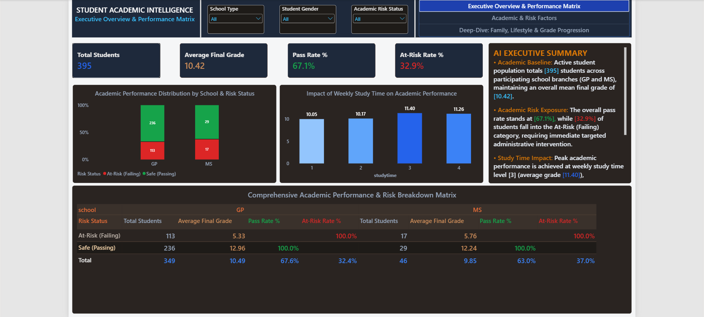
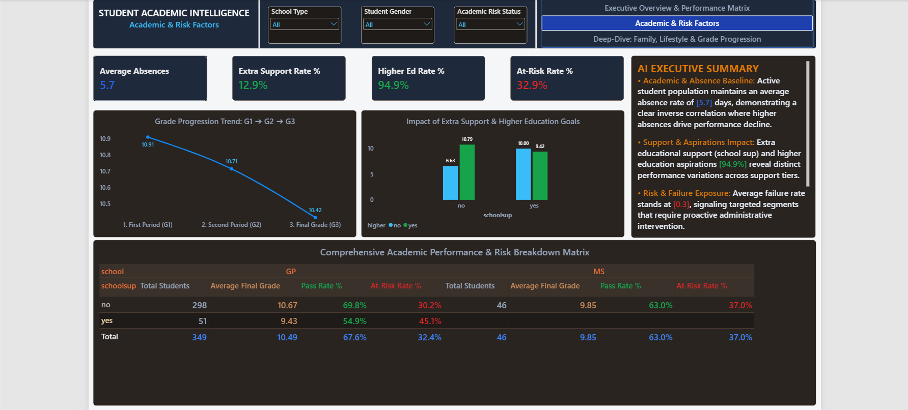
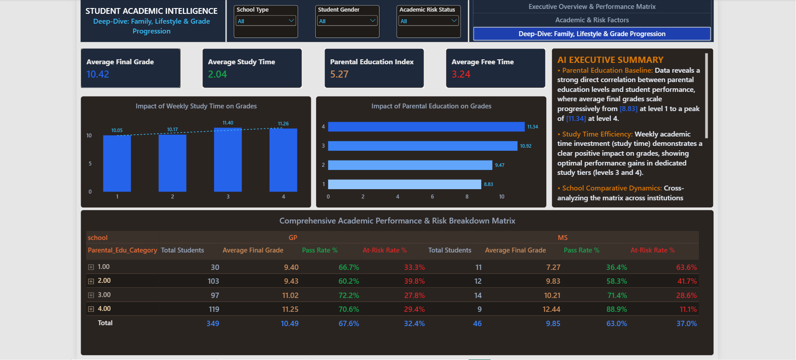

# Student Academic Intelligence & Risk Analytics Dashboard

In data-driven educational environments, tracking multi-dimensional academic performance, identifying at-risk failure patterns, and correlating family or lifestyle factors with student success require rigorous data modeling, advanced DAX measures, and an executive-grade dashboard UI/UX.

I designed and developed this end-to-end interactive 3-page Power BI intelligence dashboard to evaluate student academic trajectories, behavioral risk exposures, and socio-economic/lifestyle recovery drivers across institutional branches.

---

## Executive Summary & Performance Overview

The primary view consolidates top-level operational and academic impact metrics to provide an immediate institutional health check of student populations, pass rates, and failure risk exposure.

- **Academic Commercial KPIs:** Tracks Total Population (395 Students), Overall Mean Final Grade (10.42), Institutional Pass Rate (67.1%), and At-Risk Failure Rate (32.9%).
- **Risk Distribution Intelligence:** Categorizes student populations across institutional branches, exposing critical risk concentrations that require proactive administrative intervention.
- **Executive Guidance:** Provides real-time dynamic AI summaries synthesizing performance baselines and risk factors.

---

## Key Dashboards Included

### 1. Executive Overview & Performance Matrix

Establishes the macro-baseline between institutional branches, student volumes, and overarching risk metrics.

- **Branch-Level Breakdown:** Isolates student distribution and performance tiers across major school structures (GP and MS).
- **Global Slicers:** Features synchronized filtering capabilities by School Type, Student Gender, and Academic Risk Status.

### 2. Academic & Risk Factors

Delivers granular visibility into behavioral absences, support programs, and academic progression trends.

- **Absence & Support Impact:** Analyzes average student absences (5.7 days) alongside extra educational support rates and higher education aspirations.
- **Grade Progression Trend:** Tracks performance shifts across evaluation milestones (G1 -> G2 -> G3).

### 3. Deep-Dive: Family, Lifestyle & Grade Progression

Correlates socio-economic background, parental education levels, and weekly lifestyle routines with academic outcomes.

- **Parental Education Impact:** Maps out how parental education categories significantly elevate final grade baselines.
- **Study Time Efficiency:** Evaluates weekly study commitments against optimal academic performance gains.
- **Comprehensive Breakdown Matrix:** Cross-analyzes parental education tiers and study habits with institutional branches.

---

## Strategic Educational Insights

- **Early Risk Intervention:** Identifies that nearly 32.9% of students fall into the At-Risk category, emphasizing the necessity of targeted academic counseling.
- **Socio-Educational Correlation:** Highlights a direct positive correlation between higher parental education indices and student grade progression.
- **Behavioral Optimization:** Proves that structured weekly study investments mitigate failure exposure and drive peak performance tiers.

---

## Data Architecture & Privacy

To maintain strict data integrity while ensuring enterprise scalability, the underlying analytical model is built using industry-standard enterprise practices:
- **Star Schema Modeling:** Centralized transactional tables surrounded by standardized dimension tables for fast cross-filtering and drill-down operations.
- **Advanced DAX Logic:** Fully developed calculation engine handling dynamic threshold percentages, risk classifications, and multi-variable metric aggregations.
- **Data Governance:** Raw transactional identifiers and sensitive metrics are anonymized and structured to comply with strict educational data governance standards.
